<!-- ╔═══════════════════════════════════════════════════════════════╗
     ║  github.com/valnasio · perfil estilo valnasio.com.br          ║
     ║  Visual montado com SVGs próprios em /assets (dark · roxo→azul)║
     ║  Mantenha a pasta assets/ no mesmo repo deste README.         ║
     ╚═══════════════════════════════════════════════════════════════╝ -->

<!-- ░░░░░░░░░░░░░░░░░░░░░  HERO  ░░░░░░░░░░░░░░░░░░░░░░░ -->

<a href="https://valnasio.com.br">
  
</a>

<div align="center">

&nbsp;

<a href="https://valnasio.com.br"></a>
<a href="https://linkedin.com/in/valnasio"></a>
<a href="mailto:rafael@valnasio.com.br"></a>

</div>

&nbsp;

<!-- ░░░░░░░░░░░░░░░░░░░  01 · SOBRE  ░░░░░░░░░░░░░░░░░░░ -->


Comecei na base da operação de TI e evoluí para uma atuação estratégica, conectando **infraestrutura, redes, sistemas, automação e cloud**. Hoje direciono a carreira para **DevOps, Cloud Computing e SRE** — construindo ambientes mais seguros, automatizados, escaláveis e eficientes.

Atualmente atuo como **Infrastructure Analyst — DevOps (Mid-Level)** na Estação 1, com prática consolidada em administração de servidores Linux/Windows, virtualização, containers, sustentação de aplicações e melhoria contínua. Venho aprofundando AWS, GCP, OCI, Terraform, Ansible, Jenkins e CI/CD para **reduzir retrabalho, aumentar disponibilidade e acelerar entregas com confiabilidade**.

`DevOps & SRE` · `Infrastructure as Code` · `CI/CD` · `Cloud` · `Observability` · `Automation`

&nbsp;

<!-- ░░░░░░░░░░░░░░░░░░░  02 · STACK  ░░░░░░░░░░░░░░░░░░░ -->


<div align="center">


</div>

| Domínio | Ferramentas |
|:--|:--|
| ☁️ **Cloud** | AWS · Azure · GCP · OCI |
| ⚙️ **IaC & Automation** | Terraform · Ansible · Python · Bash |
| ♻️ **CI/CD** | Jenkins · Git · Pipelines · Continuous Delivery |
| ◈ **Systems** | Linux Server · Windows Server · Active Directory · VMware ESXi |
| 📦 **Containers** | Docker · Portainer · Swarm |
| ⇄ **Networking** | pfSense · Redes corporativas · DNS · DHCP |
| 📊 **Observability** | Zabbix · Grafana |
| 💾 **Backup & DR** | Veeam · Bacula · Cobian |

&nbsp;

<!-- ░░░░░░░░░░░░░░░  03 · EXPERIÊNCIA  ░░░░░░░░░░░░░░░ -->


```text
● mar 2026 — present   Estação 1 · Infrastructure Analyst — DevOps (Mid)   [CURRENT]
│                      on-prem + cloud · automação · monitoramento · CI/CD
│
● abr 2024 — mar 2026  Moto Clube Honda · Analista de Sistemas
│                      AWS · PABX/SIP · redes Unifi · CMS · projetos de TI
│
● set 2021 — abr 2024  Grupo Nobre · Analista de Infraestrutura de TI
│                      server admin · networking · Zabbix · Squid · ativos
│
● abr — set 2021       Inputec · Técnico de Suporte (N1 + remoto)
│
● ago 2020 — abr 2021  UNIRB · Técnico de Suporte / CPD
│
● 2014 — 2020          Yroshy Informática · Técnico em Equipamentos
```

&nbsp;

<!-- ░░░░░░░░░░░░░░░  04 · PROJETOS  ░░░░░░░░░░░░░░░ -->


<div align="center">

<a href="https://github.com/valnasio/Cloud-Storage-Migration-Tool">
  
</a>
<a href="https://github.com/valnasio/Backup-automation-issabel-to-s3">
  
</a>

<a href="https://github.com/valnasio/Automacao_Cadastro_Active_Directory">
  
</a>
<a href="https://github.com/valnasio/Backup-de-Diretorios-com-python">
  
</a>

</div>

&nbsp;

<!-- ░░░░░░░░░░░░░░░  05 · MÉTRICAS  ░░░░░░░░░░░░░░░ -->


<div align="center">


<br/>


</div>

&nbsp;

<!-- ░░░░░░░░░░░░░░░  06 · FORMAÇÃO  ░░░░░░░░░░░░░░░ -->


<table>
<tr>
<td valign="top" width="50%">

**🎓 Formação**

- **Pós · DevOps & Continuous Software Engineering**<br/><sub>PUC Minas · 2025 → 2027 · em andamento</sub>
- **Pós · Cloud Computing**<br/><sub>Anhanguera · 2025</sub>
- **Tecnólogo em ADS**<br/><sub>UNIFAN · 2022 → 2024 · concluído</sub>

</td>
<td valign="top" width="50%">

**📜 Certificações**

- **AWS Certified Cloud Practitioner** · 2023
- Fundamentos AWS — Escola da Nuvem · 2022
- Fundamentos Azure · 2021
- Windows Server 2016: Active Directory · 2021
- Redes com pfSense · Ativos com Zabbix · 2021

</td>
</tr>
</table>

&nbsp;

<!-- ░░░░░░░░░░░░░░░  07 · CONTATO  ░░░░░░░░░░░░░░░ -->


<div align="center">

<sub>Aberto a oportunidades em **Infrastructure · Cloud · DevOps** — remoto ou híbrido.</sub>

<br/>&nbsp;

<a href="https://valnasio.com.br"></a>
<a href="https://linkedin.com/in/valnasio"></a>
<a href="mailto:rafael@valnasio.com.br"></a>

<br/><br/>

<sub><code>se é repetitivo, automatize. · se falhou, aprenda. · se escala, padronize.</code></sub>

</div>
